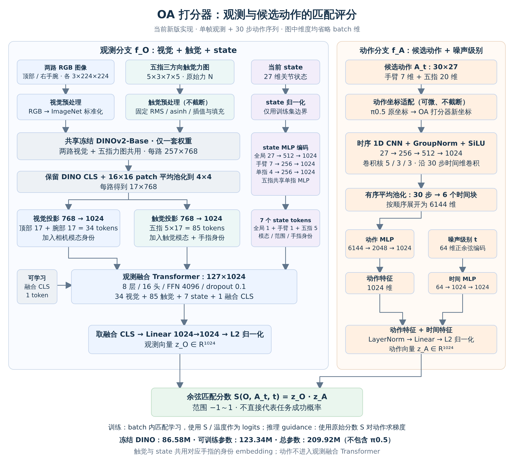

# OA 打分器：架构与重要细节

OA 表示 Observation–Action（观测–动作）。OA 打分器接收当前观测与候选动作，学习二者的匹配程度。本文描述已实现的新版架构，代码仍保留 `RecoveryStateCPM` 等旧标识。



高清 PNG 适合直接插入飞书；同目录的 SVG 可缩放。图中形状均省略 batch 维。公式采用单行 `$$...$$`，若飞书粘贴时未自动识别，在公式块中粘贴内部 LaTeX。

## 1. 总体：观测与动作分别编码，再比较

模型由观测编码器和动作编码器组成。观测编码器融合视觉、触觉与 state；动作编码器处理候选 action chunk 与它的噪声级别。两个分支最终各输出一个 1024 维向量，做 L2 归一化后计算点积，即余弦相似度。

$$z_O=\operatorname{L2Norm}(f_O(O)),\qquad z_A=\operatorname{L2Norm}(f_A(A_t,t)).$$

$$S(O,A_t,t)=z_O^{\mathsf T}z_A\in[-1,1].$$

这里的余弦相似度比较的是网络学习出的特征，不是直接比较原始关节数值与力值。分数表示匹配程度，没有经过真实执行成功率校准。

**候选动作不进入观测融合 Transformer。** 两个分支仅在最终评分处匹配。固定观测时可缓存观测向量，反复评价不同候选动作；收到新触觉或 state 后，需要重新编码观测。

## 2. 输入是什么

| 输入 | 单样本形状 | 含义 |
| --- | --- | --- |
| 顶部 RGB | 3×224×224 | 当前顶部相机图像 |
| 右手腕 RGB | 3×224×224 | 当前右手腕相机图像 |
| 五指触觉 | 5×3×7×5 | 每指 35 个点，法向／切向 0／切向 1 力，单位 N |
| state | 27 | 当前手臂 7 维＋五指各 4 维关节状态 |
| 候选动作 | 30×27 | 30 步动作；手臂 7 维为相对当前 state 的目标增量，手指 20 维为绝对关节目标 |
| 噪声级别 t | 标量 | 动作处于哪个去噪阶段；不是任务阶段或动作 chunk 的第几步 |

当前版本使用单帧观测，不输入触觉历史、腕部六维力或显式任务阶段标签。state 与 action 都有 27 维，但含义、时间长度和编码网络不同，不共享编码器权重。

## 3. 视觉和触觉：共享冻结 DINO

两路视觉图像先按现有读取流程准备为 224×224，再执行一次 ImageNet 标准化。

触觉按固定通道 RMS 进行有符号 asinh 映射，零力对应像素 0.5。7×5 力图双线性放大为 224×160，左右各补 32 像素，补值 0.5，最后执行一次 ImageNet 标准化。映射不截断；法向与两路切向作为三个输入通道，不是真实光学 RGB。

**两路视觉与五指触觉共用一套冻结 DINOv2-Base 权重。** 每路得到 1 个 DINO CLS 与 256 个 patch token，特征宽度 768。保留 CLS，把 16×16 patch 网格平均池化为 4×4，得到每路 17 个 token，再用可训练投影映射到 1024 维。

视觉分支的两路相机共享视觉投影；触觉使用另一套触觉投影。相机 token 加各自模态身份，触觉 token 加触觉模态与对应手指身份。

| 观测组成 | token 数 |
| --- | ---: |
| 顶部＋右手腕视觉 | 2×17＝34 |
| 五指触觉 | 5×17＝85 |
| state | 7 |
| 可学习融合 CLS | 1 |
| 合计 | 127 |

这里保留的七个 DINO CLS 分别属于七路图像特征；额外的融合 CLS 是另一个可学习 token，用于汇总整个观测。

## 4. state：全局、手臂与五指的分层表达

27 维 state 经打分器专用归一化后，构成以下 token：

| 范围 | 编码器 | token 数 |
| --- | --- | ---: |
| 全局 | MLP：27→512→1024 | 1 |
| 手臂 | MLP：7→256→1024 | 1 |
| 每根手指 | MLP：4→256→1024，五指共用同一套权重 | 5 |

各 MLP 使用 SiLU 和输出 LayerNorm。state token 再加 state 模态、global／arm／finger 范围身份。手指 state 与对应触觉使用**同一个可学习手指身份 embedding**，让融合网络能够识别两种模态属于同一根手指。

全局 token 提供整体姿态；局部 token 保留每根手指的信息。state 有 7 个 token，并不意味着它的作用被固定为 7/127；注意力权重和最终贡献由训练学习，需要消融实验验证。

## 5. 观测融合 Transformer

输入为 127×1024。配置为 8 层、16 个注意力头、FFN 宽度 4096、dropout 0.1、GELU、pre-norm，编码器末尾另有 LayerNorm。

视觉、触觉与 state 在这些层中进行自注意力融合。取融合 CLS 的输出，经过 1024→1024 线性投影与 L2 归一化，得到观测向量。候选动作不参与这一步。

## 6. 动作：时序 CNN 与噪声级别编码

动作输入是 30×27，经可微坐标适配进入打分器的归一化坐标，然后沿时间维进行三层 Conv1D：

```text
27→256，kernel=5 → GroupNorm(8组) → SiLU
256→512，kernel=3 → GroupNorm(8组) → SiLU
512→1024，kernel=3 → GroupNorm(8组) → SiLU
AdaptiveAvgPool1D：30步→6个有序时间块
Flatten：6×1024＝6144
MLP：6144→2048→1024
```

卷积保持时间长度，池化才将 30 步压缩为 6 个时间块。六块按时间顺序展开，保留粗粒度先后关系；不是将整个动作序列一次平均，也不保持全部逐步细节。

噪声级别 t 先转成 64 维正余弦特征，再通过 MLP：64→1024→1024，与动作特征相加，经过 LayerNorm、1024→1024 线性投影和 L2 归一化，得到动作向量。

时间编码使模型能根据噪声程度评价候选动作。训练约定 t=0 为干净动作，t 越大噪声越强；不应与采样器相反的时间约定直接混用。

训练中先在 π0.5 的原动作坐标内加噪声，再转换到打分器新坐标：

$$A_t^{\pi}=(1-t)A^{\pi}+t\epsilon,\qquad\epsilon\sim\mathcal N(0,I).$$

**不能直接在打分器的新坐标内重新加标准高斯，** 否则会改变噪声分布，使训练和后续 guidance 的输入约定不同。state 和 action 的新边界仅用干净＋10 倍增强的训练数据拟合，三种训练比例共用，不用验证集拟合，也不改变 π0.5 自身的统计。

## 7. 训练评分与推理 guidance 的区别

训练对一个 batch 的全部观测与动作计算 B×B 评分矩阵。来源匹配的对角项作为正配对，非对角项作为身份负配对；相近动作的负配对按既有策略忽略或降权。使用双向加权对比损失。

训练分类 logits 使用评分除以可学习温度；guidance 使用原始余弦分数：

$$\mathrm{logits}_{ij}=S_{ij}/\tau,\qquad g=\nabla_{A_t}S(O,A_t,t).$$

训练阶段只更新 OA 打分器，不需要加载 π0.5。后续推理才加载 π0.5 与打分器，通过动作梯度进行局部引导；梯度路径经过动作分支与可微坐标适配，观测分支在本次修正中保持固定。

## 8. 参数量与需要验证的重点

| 类别 | 参数量 |
| --- | ---: |
| 冻结 DINO | 86,580,480（86.58M） |
| 可训练部分 | 123,342,081（123.34M） |
| 总参数 | 209,922,561（209.92M） |

以上不包含 π0.5。投影、身份 embedding、state MLP、融合 Transformer、动作编码器和温度参与训练；DINO 保持冻结与 eval。

需要验证三个关键点：模型是否真正利用触觉而不是只依赖 state；分数梯度是否改善接触而非只提高分数；完整任务中是否保持动作合理性。当前配对与恢复标签属于监督数据，不意味着已经验证了物理可行性或任务成功概率。

实现来源：`src/openpi/touchguide/recovery_model.py`、`model.py`、`normalization.py`、`tactile_dino.py`。配置来源：全量增强数据 `ratio_1_1/config/cpm.json`。图和说明只描述当前实现，不将未来 guidance 方案画成已实现部分。
