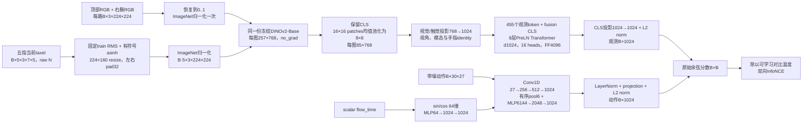

# Poker CPM：共享冻结DINOv2-Base与对比损失

当前实现使用一份共享、冻结的DINOv2-Base编码两路视觉和五指触觉，再训练CPM投影、融合层、动作编码器与温度。正式CPM训练尚未启动，也未创建W&B run。旧版CNN实现说明已保存为 [touchguide_cpm_network_cnn_v1.md](touchguide_cpm_network_cnn_v1.md)。

论文采用冻结的预训练DINOv2编码视觉与触觉，以Transformer融合观测，再与1D CNN + MLP动作嵌入计算余弦匹配分数；Table VIII报告118M可训练参数。[TouchGuide IV-B、Appendix C / Table VIII](https://arxiv.org/html/2601.20239v6)。本版可训练参数约122.26M，与该规模接近；论文未公布这里使用的精确DINO变体、层宽、层数或token池化实现，因此这些细节是本地适配，不声称逐项复现作者网络。

## 输入与参数

模型输入为当前顶部与右腕RGB、当前右手五指三通道taxel力图，以及带噪候选动作和噪声时刻。RGB为`[B,3,224,224]`、范围`[-1,1]`；触觉为`[B,5,3,7,5]`、单位N，通道依次为normal、tangent-0、tangent-1；动作为已归一化的`[B,30,27]`。27维由7维手臂增量和20维手指绝对目标组成，使用数据入口固化的pi0.5 step20k归一化统计。

不输入独立机器人状态、F6、历史力、任务阶段、成功标签或pi0.5输出；模型构造与CPM训练均不加载pi0.5模型。

| 参数范围 | 数量 |
| --- | ---: |
| CPM可训练参数 | 122,262,529 |
| 共享冻结DINOv2-Base | 86,580,480 |
| 总参数 | 208,843,009 |

## 网络结构



DINO保持`eval`和`requires_grad=False`，一次共享前向接收两路RGB及五路触觉图，按最多16张图分块执行`no_grad`。每张224×224图产生1个CLS和16×16个patch token。保留原CLS，将patch网格按2×2均值池化为8×8；每图因此有65个token。两路视觉和五指触觉共`7×65=455`个token，再加一个可训练fusion CLS，融合序列长456。

视觉投影与触觉投影分别为768→1024；两路视觉共享视觉投影，五指共享触觉投影。模态/视角与手指identity为可训练嵌入。融合Transformer使用8层、宽1024、16个attention head、FFN宽4096、GELU、PreLN和dropout=0.1，最终CLS经1024→1024投影及L2归一化。克隆的融合层独立初始化。

动作编码器使用三层时间Conv1D，通道27→256→512→1024，按时间顺序池化为6个bin，展平后通过6144→2048→1024 MLP。64维sin/cos噪声时刻经64→1024→1024 MLP后加入动作特征，最后经过LayerNorm、1024→1024投影与L2归一化。动作不在模型内再次归一化或裁剪。

对比温度通过log inverse temperature学习，初值0.07，限制为[0.01,1]。这些数值、显式time embedding、动作网络宽度、池化及融合结构均为本地配置。噪声时刻`flow_time`与InfoNCE温度是两个不同量。

## 触觉到DINO图像的本地映射

`TactileDinoPreprocessor`使用三个固定、正值的train-only通道RMS，不使用逐帧归一化、分位数裁剪或硬clip。映射公式为：

```text
image = 0.5 + asinh(force / rms) / (2 * asinh(32))
```

零力固定为0.5；正、负力分布在0.5两侧，通道和符号不重排。±32倍RMS对应约1和0，更大的幅值允许超出[0,1]，保持外推。原始小taxel网格上的除法与asinh采用FP64，避免极端有限FP32输入的溢出和反向平方溢出；之后resize及输出为FP32，DINO不执行FP64。

每指3×7×5力图先映射，再以bilinear、`align_corners=False`放大为3×224×160，左右各pad32，未ImageNet归一化的padding恒为0.5，以保持7:5空间几何。五指按batch-major、finger-minor顺序展平。`encode_image`返回未ImageNet归一化图；`forward`仅再做一次ImageNet mean/std归一化。

触觉像素通过独立`forward_pixels`接口进入DINO，不经过视觉RGB的`[-1,1]`检查、恢复范围或二次归一化。预处理本身可导，冻结DINO的`no_grad`路径不训练触觉或视觉backbone。

该asinh公式和几何处理是为7×5仿真taxel定义的本地适配，不是作者公布的触觉预处理公式。当前版本没有旧版空间CNN、幅值MLP或可训练no-contact token；空触觉自然映射为固定中性图像。

## 损失与分数

对余弦矩阵S与可学习对比温度tau：

```text
logits = S / tau
loss_obs_to_action = CE(logits, arange(B))
loss_action_to_obs = CE(logits.T, arange(B))
loss = (loss_obs_to_action + loss_action_to_obs) / 2
```

交叉熵直接接收logits。targets与正负mask必须描述对角身份配对；B至少为2。每行一个同身份正配对，其他列为不同身份负配对。这些标签表示示范匹配，不表示经过物理验证的成功或失败。

指标包含总损失、两个方向的损失/Top-1匹配准确率、正负原始余弦均值、差值和温度。batch64的均匀分数基线为`log(64)=4.158883`、准确率`1/64`；匹配准确率不是机器人任务成功率。

## 接口与未来guidance

配置位于数据入口`config/cpm.json`，train/val配置引用该文件。网络只加载本地校验过的`facebook/dinov2-base`，不下载、不随机fallback。固定revision为`f9e44c814b77203eaa57a6bdbbd535f21ede1415`，权重SHA256为`d73036b56966966d07975d696bde331762f37297e2f095de8cea0040c3aa0841`；其他文件hash和来源记录在`backbone_manifest.json`。

```python
from openpi.touchguide.losses import cpm_contrastive_loss
from openpi.touchguide.model import CPMModel
from openpi.touchguide.noise import NoiseAugmentedBatchLoader

model = CPMModel.from_config(root)
loader = NoiseAugmentedBatchLoader.from_config(root, "train", epoch=0)
batch = next(iter(loader))
output = model(batch)  # noisy_actions和flow_time显式参与计算
metrics = cpm_contrastive_loss(output, batch)
loader.dataset.close()
```

正式训练入口见 [touchguide_cpm_training.md](touchguide_cpm_training.md)。移动到GPU时模型与batch张量应一起移动，sample IDs及其他元数据仅辅助采样和记录。

未来guidance可缓存观测，然后对候选动作求原始余弦分数梯度：

```python
model.eval().requires_grad_(False)
with torch.no_grad():
    observation = model.encode_observation(head, wrist, tactile_map_raw)
candidate = noisy_action.detach().requires_grad_(True)
score = model.paired_scores(observation, candidate, flow_time)
gradient = torch.autograd.grad(score.sum(), candidate)[0]
```

`paired_scores`支持对应观测/动作，或一个缓存观测与多个候选。它不使用softmax或训练温度，也不detach候选动作。当前仅提供评分与梯度接口，尚未修改pi0.5 sampler或启动guidance评估。

## 文件与验证范围

- `src/openpi/touchguide/model.py`：共享冻结DINO、token池化、投影、融合、动作编码与评分。
- `src/openpi/touchguide/tactile_dino.py`：固定RMS/asinh触觉图像映射。
- `src/openpi/touchguide/losses.py`：对称匹配损失与指标。
- `src/openpi/touchguide/train.py`、`checkpoint.py`：训练循环、完整checkpoint与严格续训。
- `scripts/touchguide/prepare_dinov2_base.py`、`prepare_cpm.py`：公开backbone校验和配置/来源准备。
- `scripts/prepare_poker_touchguide_cpm.sh`：准备入口；`scripts/train_poker_touchguide_cpm.sh`：正式启动入口。

触觉预处理CPU合成回归已验证零力、符号、幅值、通道、固定padding、batch/finger独立、空间方向、有限差分梯度，以及最大有限FP32输入的有限无裁剪输出和非零梯度。独立损失公式回归、微型假模型的trainer/checkpoint/续训回归已通过；这些合成检查不代表新版实际CPM已经训练。

已完成H20真实batch64、BF16的前向/反向及一组固定验证数据的10个噪声时刻检查。显存峰值allocated=11.248 GiB、reserved=11.602 GiB；所有可训练参数梯度有限，冻结DINO无梯度。候选动作对原始分数的梯度非零，去掉非零触觉会改变观测编码。该诊断不执行optimizer.step、不创建W&B run、不保存训练权重；未分配AdamW状态，后续训练额外状态估计约0.91 GiB，并应保留额外显存余量。报告位于数据目录`meta/cpm_training_gpu_validation.json`。这些接口检查不代表模型已学会任务。
