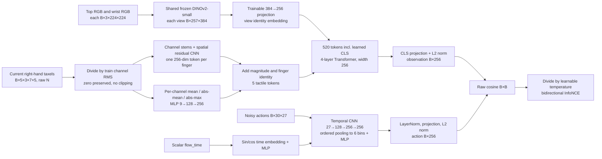

# Poker CPM network and loss (historical CNN v1)

This document records the retired CNN version. Use [the current DINO CPM guide](touchguide_cpm_network.md) for active scripts and checks.

The local TouchGuide checkout does not include the CPM network or trainer
(its README still lists TouchGuide code as TODO). This is an implementation of
the publicly described method, with explicitly documented local adaptations.
See [TouchGuide IV-B, Appendix C and L2](https://arxiv.org/html/2601.20239v6).

The model consumes two current RGB views, five current three-channel force maps,
and normalized noisy candidate actions. No independent robot-state, F6, history,
base pi0.5 output or success label is an input. It does not instantiate pi0.5.

## Architecture



- DINOv2 is frozen and stays in eval mode when the CPM trains. RGB is already
  resized/padded by the reader; convert [-1,1] back to [0,1], then apply ImageNet
  normalization once. DINO is loaded exclusively from verified local safetensors.
- DINO's CLS and 16×16 patch tokens are retained for each view. Five finger tokens
  plus a fusion CLS produce 520 tokens. The fusion Transformer has 4 layers,
  width 256, 8 heads, FFN width 1024 and dropout 0.1.
- Reuse the existing small-grid tactile CNN **architecture**, freshly initialized
  for CPM. Its parameters receive contrastive gradients. It uses train-only
  channel RMS rather than the older encoder's quantile/clipping transform.
- GroupNorm can suppress common force amplitude. A lightweight branch from
  each channel's mean, mean absolute value and maximum absolute value bypasses
  that normalization. It derives nine numbers per finger from the same current
  maps; it does not add a separate force-sensor input.
- Fingers below the 1e-6 N taxel threshold have their spatial CNN output masked,
  preventing stacked GroupNorm from amplifying zero-map gradients. A learned
  no-contact token encodes the empty-contact state. The gate derives solely from
  current taxels and does not consume auxiliary contact labels.
- Actions keep their normalized 27 coordinates and 30-step horizon. The temporal
  CNN and ordered six-bin pooling preserve temporal structure before projection.
- Explicit flow-time conditioning is a local choice; the paper's score formula
  does not specify this embedding implementation. No action clipping or second
  normalization is performed by the model.
- Temperature is learnable via log inverse temperature, initialized at 0.07 and
  bounded to [0.01,1]. These numerical settings are local choices.

Paper choices reproduced: frozen pretrained visual DINOv2, Transformer fusion,
1D CNN + MLP action encoding, L2 cosine scores, learnable temperature, symmetric
InfoNCE. Small-grid tactile encoding, exact dimensions, pooling, explicit time
embedding and temperature bounds are local adaptations. No claim of identical
official implementation or 118M paper parameter count is made.

## Loss and metrics

For cosine score matrix S and learnable temperature tau:

```text
logits = S / tau
loss_obs_to_action = CE(logits, arange(B))
loss_action_to_obs = CE(logits.T, arange(B))
loss = (loss_obs_to_action + loss_action_to_obs) / 2
```

Cross entropy takes logits directly. Diagonal targets and identity masks are
checked explicitly. Labels mean matched identities, not verified physical task
success or failure. B must be at least 2. Uniform scores give loss=log(B), so a
batch of 64 has a 4.158883 baseline; loss depends on the actual number of negatives.

Returned metrics include total and directional losses, both top-1 matching
accuracies, mean positive/negative raw cosine, their gap, and temperature.
Matching accuracy is an offline metric, not a robot task success rate.

## Interface

Config lives in the dataset entry's `config/cpm.json`; train/val configs reference it.

```python
from openpi.touchguide.model import CPMModel
from openpi.touchguide.losses import cpm_contrastive_loss
from openpi.touchguide.noise import NoiseAugmentedBatchLoader

model = CPMModel.from_config(root)
loader = NoiseAugmentedBatchLoader.from_config(root, "train", epoch=0)
batch = next(iter(loader))
output = model(batch)  # explicitly uses noisy_actions and flow_time
metrics = cpm_contrastive_loss(output, batch)
# Future trainer may call metrics['loss'].backward() and its optimizer.
loader.dataset.close()
```

When moving to GPU, move the model and batch tensors together. IDs/metadata remain
auxiliary; targets/masks can remain on CPU because the loss handles device transfer.
The network constructor does not download weights and never falls back to random DINO.

Future guidance can cache the observation once and differentiate raw cosine:

```python
model.eval().requires_grad_(False)
with torch.no_grad():
    observation = model.encode_observation(head, wrist, tactile_map_raw)
candidate = noisy_action.detach().requires_grad_(True)
score = model.paired_scores(observation, candidate, flow_time)
gradient = torch.autograd.grad(score.sum(), candidate)[0]
```

`paired_scores` returns one raw score per aligned pair, or multiple candidates for
one cached observation. It does not apply softmax or training temperature. This
step only exposes and checks the gradient API; it does not modify the pi0.5 sampler.

## Files and checks

- `src/openpi/touchguide/model.py`: backbone, observation/action encoders and scoring.
- `src/openpi/touchguide/losses.py`: symmetric matching loss and diagnostics.
- Historical DINOv2-Small downloader: removed after switching to DINOv2-Base.
- `scripts/touchguide/prepare_cpm.py`: one-time configuration/provenance preparation.
- `scripts/prepare_poker_touchguide_cpm.sh`: preparation entry, no training.
- `scripts/touchguide/validate_cpm_losses.py`: independent loss formula/gradient checks.
- `scripts/touchguide/validate_cpm_model.py`: real small-batch forward/backward and action-gradient checks.

The backbone is `facebook/dinov2-small`, revision
`ed25f3a31f01632728cabb09d1542f84ab7b0056`, prepared at
`/path/to/datasets/sim/poker-draw/pi05_trex/touchguide/backbones/dinov2_small_ed25f3a`.
Its source URLs, byte sizes and SHA256 are in `backbone_manifest.json`.

Validation reports belong to the data entry's `meta/cpm_loss_validation.json` and
`meta/cpm_model_validation.json`. These checks have no optimizer step, checkpoint,
base-model loading, simulation or formal training run. Network and loss readiness
does not establish learned physical guidance performance; CPM training is next.

## Completed CPU validation

Total parameters: 27,702,561 (27.70M); trainable: 5,645,985 (5.65M); frozen DINOv2: 22,056,576 (22.06M).
The independent loss check and real three-sample RGB/taxel/noisy-action check passed. All trainable components receive finite gradients; the frozen backbone receives none. Empty-contact spatial gradients are zero while the learned no-contact token receives an effective gradient. With every model parameter frozen, raw-score action gradients are finite and nonzero and agree with a directional finite-difference check. Force-amplitude and noise-time probes change the embeddings; these checks do not establish trained performance. Ruff lint and format checks passed.
