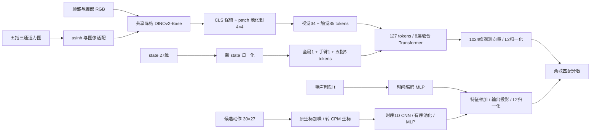

# 新版 Recovery State-CPM：数据构建、模型训练与评价指标

> **飞书公式使用方式**：本文行内和独立公式统一使用 `$$公式内容$$`，公式与两侧的 `$$` 紧邻，不在边界加空格或换行。粘贴到飞书后如果显示为普通文本，删除末尾一个 `$` 再重新输入；也可以输入 `/eq` 打开公式编辑器，粘贴去掉两侧 `$$` 的 LaTeX 内容，再按 Esc 完成。说明依据：[飞书官方公式说明](https://www.feishu.cn/hc/zh-CN/articles/894598450617-在文档中使用公式)。

> 版本：`recovery-state-cpm`，2026-10-13。本文依据本地实现和生成报告整理。
>
> 项目：`/path/to/guidence-touch`。
>
> 本文描述已经实现的功能，并把尚需执行验证的部分单独标明。当前方法借鉴 TouchGuide 的观测—候选动作对比匹配与可微打分思路；指尖增强规则、state 分支、token 分配、归一化和负配对降权属于我们的本地设计。

## 1. 这个模型要解决什么问题

我们的目标是训练一个能够利用当前视觉、触觉和机器人关节状态，评价候选动作是否与当前接触状态匹配的打分器。后续在 π0.5 生成动作时，可以固定观测，对候选动作求评分梯度，得到局部修正方向。

传统干净示范只提供“正常观测应该对应什么任务动作”。如果部署时手指位置稍有偏差、某根手指的接触变弱或消失，模型未必知道应该如何恢复。因此，新版数据增加了另一类正配对：

- **干净配对**：原始观测 → 原示范中继续执行任务的动作。
- **增强配对**：扰动后的 state 和合成触觉 → 从扰动 state 平滑回到原始当前 state 的恢复动作。

两个配对都是对比学习中的正配对。增强样本不会因为观测被扰动就统一被标成“失败”或“低分”。

CPM 输出的是**观测与动作的匹配分数**，不是经过真实执行验证的成功概率，也不是强化学习的长期 Q 值。训练阶段只训练 CPM，不加载或更新 π0.5。

## 2. 输入、输出与动作约定

设一个观测为：

$$O_i=(I_i^{\mathrm{head}},I_i^{\mathrm{wrist}},T_i,q_i).$$

| 输入 | 原始内容 | 模型读取时的形状 | 说明 |
| --- | --- | --- | --- |
| 顶部相机 `head` | 当前 RGB 图像 | `[B,3,224,224]` | 保持图像比例缩放、补边后读取 |
| 右腕相机 `wrist` | 当前 RGB 图像 | `[B,3,224,224]` | 与顶部图像组成两个视觉视角 |
| 触觉 `tactile_map_raw` | 五指三方向力分布，单位 N | `[B,5,3,7,5]` | 每指 35 个 taxel，三个通道为法向、切向 0、切向 1 |
| `state_raw` | 当前关节位置，单位 rad | `[B,27]` | 右臂 7 维 + 右手 20 维 |
| 候选动作 | 未来 30 个关节指令 | `[B,30,27]` | 动作编码器接收带噪动作及噪声时刻 |
| `flow_time` | 动作噪声时刻 | 标量或 `[B]` | 训练时整个 global batch 共用一个时刻 |

五指顺序固定为：拇指、食指、中指、无名指、小指。每指进入 state 的关节数为 4；拇指使用 joint1、joint2、joint3、joint5，其余手指使用 joint1～joint4。运动学内部还处理被动拇指关节的耦合，但不增加模型输入维度。

**state 和 action 虽然都是 27 维，含义并不完全相同：**

- state：手臂和手指都是当前绝对关节位置。
- action：手臂 7 维是相对该动作所属观测的增量；手指 20 维是绝对关节目标。

设存储的绝对目标序列为 $$Q_i^{\mathrm{target}}[h]$$，当前 state 为 $$q_i$$，则动作的物理坐标为：

$$A_i^{\mathrm{phys}}[h] =\big(Q_{i,\mathrm{arm}}^{\mathrm{target}}[h]-q_{i,\mathrm{arm}},\; Q_{i,\mathrm{hand}}^{\mathrm{target}}[h]\big).$$

新版不输入腕部六维力、语言、触觉历史或显式任务阶段标签。当前 state 与触觉都是当前时刻的单帧输入。未来增加历史或六维力分支属于后续版本。

## 3. 干净数据从哪里来

### 3.1 来源与接触起点筛选

原始数据来自 `poker_0920_200` 的 200 条 episode：

```text
/path/to/datasets/sim/poker-draw/pi05/0920_200
```

已有 CPM 数据入口提供来源索引、归一化统计等信息：

```text
/path/to/datasets/sim/poker-draw/pi05_trex/touchguide/cpm_datasets/poker_0920_200_touchguide_v1
```

新版重新读取原始 episode 的连续帧，**stride=1，不再每 4 帧选一个起点**。起点需要同时满足：

1. 当前 state 和触觉数值有限。
2. 后续存在完整的 30 步动作 chunk，且指令数值有限。因此 episode 尾部不能构成完整 chunk 的帧不保留。
3. 至少一根手指的法向合力大于 `0.001 N`。

第 $$f$$ 根手指的接触标志定义为：

$$F_{n,f}=\sum_{u,v}T_{f,n,u,v},\qquad c_f=\mathbb{1}[F_{n,f}>0.001\ \mathrm{N}].$$

这是本地的接触活跃阈值，不是经过真机标定的传感器噪声下限。

每个干净起点保留原始两路图像、触觉、当前 state，以及原示范的未来 30 步动作。数据标称频率为 30 FPS，因此 30 步对应示范数据中的约 1 秒。此处不决定推理时一次执行多少步，也不决定部署的实际推理频率。

### 3.2 训练与验证划分

按照 episode 划分：180 条训练、20 条验证，seed=42。同一条 episode 的干净起点及全部增强样本继承相同 split，避免同一轨迹的不同扰动分别进入训练和验证。

最终保留 **129,196 个干净配对**：训练 116,269 个，验证 12,927 个。

### 3.3 接触局部坐标

增强需要知道每根手指“远离接触”“靠近接触”和两个切向方向。当前实现使用原始仿真记录中的接触反力、接触质心和指腹几何，建立局部坐标：

$$(n_f,t_{f,0},t_{f,1}).$$

其中法向正方向表示远离接触，负方向表示靠近接触。接触几何会检查记录的一致性、有效质心、法向一致性等；法向 coherence 下限为 0.9，相关时钟差检查上限为 1/30 秒。

只有**原本有接触、且接触几何可靠**的手指才能参与增强。一个起点不意味着五根手指都能被扰动。本版使用已有仿真接触记录，不依赖推理时拿到牌的真值位姿；也没有实现从真机触觉单独估计同等精度接触几何的完整流程。

## 4. 指尖扰动如何生成

### 4.1 每指独立选择，再组合成一个增强观测

每个干净起点生成 10 个不同的增强变体。对每根可增强手指，随机决定：

1. 是否扰动。
2. 有符号法向位移，允许为 0。
3. 有符号切向 0 位移，允许为 0。
4. 有符号切向 1 位移，允许为 0。
5. 接触目标：保持接触或失去接触。

不同手指可以选择相同或不同的方向、幅度，不强制相同，也不强制不同。支持单指、多指、纯法向、纯切向，以及单指同时包含法向和切向的组合。

具体 rules：

| 参数 | 当前值 | 含义 |
| --- | --- | --- |
| 每指扰动概率 | 0.65 | 可行手指独立抽取是否参与 |
| 分量抽样时的置零概率 | 0.35 | 允许只扰动部分轴 |
| 非零分量幅度 | 0.25、0.5、0.75、1、1.25、1.5、2 mm | 幅度独立选择，符号可正可负 |
| 单指位移向量长度上限 | 2 mm | 限制合成向量长度，不只是每个分量 |
| 同时可实现保持/失去接触时，失去接触目标概率 | 0.25 | 不保证最终全数据正好有 25% 失去接触 |
| 保持接触的正法向候选 | 0.25、0.5、0.75 mm | 最终还需用实际 IK 位移验证 |
| 失去接触的正法向候选 | 1.25、1.5、2 mm | 按合成规则检查是否达成目标 |
| 每起点变体数 | 10 | 变体去重后保留 |
| 随机种子 | 42 | 用于可复现构建 |

**最终分布是受约束的随机分布。** 实现先建立每指可行候选池，再按接触目标和分量组合抽样。候选还要满足 IK、位移长度、关节和接触规则。不能把表中的抽样概率解释为生成数据中的精确占比。

全部手指都不变化的组合不保留；未选择或不满足可靠接触条件的手指保持原值。本版不在原本无接触的手指上凭空创造新接触。

### 4.2 指尖位移到关节 state：局部 IK

第 $$f$$ 根手指的目标世界位移为：

$$\Delta p_f=d_{n,f}n_f+d_{0,f}t_{f,0}+d_{1,f}t_{f,1}.$$

从原始 state 出发，用 MuJoCo 模型的静态运动学逆解相应手指的关节位置。只优化被选择手指的关节；**手臂 7 维和未选择的手指保持不变**。

筛选条件：

- IK 指尖位置误差 ≤50 μm。
- 相对于原 state，每个关节改变量 ≤0.15 rad，且满足模型关节范围。
- 指腹姿态变化 ≤15°。
- 实际 FK 指尖位移长度 ≤2 mm。
- IK 后的实际法向位移能够满足该手指所选的合成接触目标。

触觉合成使用的是 **IK 得到的实际 FK 位移**，并不是直接把要求的位移当作已实现的位移。IK/FK 检查验证的是运动学一致性；当前生成过程没有通过物理 rollout 验证牌的动态变化、手指间碰撞或抓取是否能成功。

## 5. 触觉怎样随 state 一起变化

本版采用“已有接触分布 + 局部形变 + 力增益”的合成方式。它提供带有接触依据的训练增强，不能作为真实接触动力学真值。

### 5.1 法向合力增益

将实际指尖位移投影到远离接触的法向：

$$d_f=\Delta p_f\cdot n_f.$$

设释放距离 $$d_{\mathrm{release}}=1\ \mathrm{mm}$$，定义：

$$g_f=\operatorname{clip}\left(1-\frac{d_f}{d_{\mathrm{release}}},0,3\right).$$

合成法向合力满足：

$$\widetilde F_{n,f}\approx g_f F_{n,f}.$$

例如在本地合成规则中：

| 实际法向位移 | 增益 | 含义 |
| --- | ---: | --- |
| 远离 0.5 mm | 0.5 | 法向合力约减半 |
| 远离 ≥1 mm | 0 | 接触力归零 |
| 靠近 0.5 mm | 1.5 | 法向合力约增加到 1.5 倍 |
| 靠近 2 mm | 3 | 达到增益上限 |
| 纯切向位移，法向投影为 0 | 1 | 法向合力保持，空间分布可以改变 |

这里的 `clip` 是**接触合成增益的规则**，不是输入归一化的截断。当前输入归一化不做硬截断。1 mm 和增益上限 3 都是本地假设，尚未标定成真实材料刚度或真实接触释放距离。

### 5.2 如何分配到 35 个 taxel

没有把合力平均分到 35 个接触点。模型以原始 taxel 分布为基础，根据扰动前后的 taxel 世界位置与原接触质心的距离，改变各点的相对权重。

设原法向 taxel 力为 $$b_k$$，扰动前后位置为 $$p_k,p'_k$$，接触质心为 $$c$$，高斯宽度 $$\sigma$$ 沿用来源触觉记录中的 kernel 参数：

$$r_k=\exp\left(\frac{\|p_k-c\|^2-\|p'_k-c\|^2}{2\sigma^2}\right), \qquad \bar r_k=\frac{r_k\sum_l b_l}{\sum_l b_l r_l}.$$

合成法向力为：

$$\widetilde b_k=g_f\bar r_k b_k.$$

数值实现对指数做稳定化处理。这种归一化让空间重分配保持法向总量，再由 $$g_f$$ 控制总量变化。原本为 0 的 taxel 在这套乘性变形中仍为 0，因此它不具备物理模拟中新接触区域出现的完整能力。

两个切向通道保留原来有符号的力；先按扰动后的指腹切向基做方向投影，再乘空间权重和增益。**本版没有根据切向位移或速度额外计算真实摩擦、滑移或库仑摩擦模型。**

### 5.3 接触判定与视觉处理

合成触觉仍用 `sum(normal taxels)>0.001 N` 判断接触。所选手指可能“有接触→无接触”或保持接触；本版不构造“原无接触→新接触”。

两路视觉保持原始图像。这基于毫米级指尖扰动在当前相机视角下可能不明显的近似；**并不意味着图像与扰动 state 已经物理严格一致**。

## 6. 恢复动作如何构造

增强后的 state 记作 $$\widetilde q_i$$，原始当前 state 为 $$q_i$$。恢复终点是 $$q_i$$，不是示范未来第 30 步的状态。

使用 30 步最小 jerk 的五次插值：

$$u_h=\frac{h}{30},\qquad \alpha_h=10u_h^3-15u_h^4+6u_h^5,$$

$$Q_i^{\mathrm{rec}}[h]=\widetilde q_i+\alpha_h(q_i-\widetilde q_i), \qquad h=1,\dots,30.$$

它具有以下性质：

- 隐含第 0 步是扰动 state；保存的 action 是未来第 1～30 步目标。
- 最后一步精确回到干净当前 state。
- 理想连续插值两端速度、加速度为 0，关节目标平滑变化。
- 未扰动关节保持原值，手臂始终保持原值。
- 不同扰动起点到相同终点，会得到不同的中间目标轨迹。

因此，我们没有把整个 chunk 写成 30 个完全相同的终点坐标。

再按第 2 节的动作约定转换：手臂目标减增强观测当前手臂 state，得到 7 维增量；手指保留绝对目标。由于手臂没有被扰动，恢复样本的手臂动作增量为 0。

当前整个 30 步都是恢复，**没有在恢复之后追加原任务的后续动作**。这是当前设计选择，也意味着增强比例太高时，模型可能更偏好“回到当前示范姿态”的动作，未必更偏好推进任务。需通过后续任务执行评价验证，不能仅由 π0.5 的基础输出推断一定不会停滞。

最终增强正配对为：

$$(\widetilde O_i,A_i^{\mathrm{rec}}) =\big((I_i^{\mathrm{head}},I_i^{\mathrm{wrist}},\widetilde T_i,\widetilde q_i),A_i^{\mathrm{rec}}\big).$$

## 7. 数据量、三个比例与存储

数据根目录：

```text
/path/to/datasets/touchguidence/augmentation/poker_fingertip_recovery_rules_v1_random10
```

每个干净起点生成 10 个不同增强变体，共 **1,291,960 个增强配对**。

| 干净:增强 | 训练干净 | 训练增强 | 训练合计 | 验证合计 | 全部配对 |
| --- | ---: | ---: | ---: | ---: | ---: |
| 1:1 | 116,269 | 116,269 | 232,538 | 25,854 | 258,392 |
| 1:5 | 116,269 | 581,345 | 697,614 | 77,562 | 775,176 |
| 1:10 | 116,269 | 1,162,690 | 1,278,959 | 142,197 | 1,421,156 |

三套训练入口是：

```text
ratio_1_1/
ratio_1_5/
ratio_1_10/
```

**没有分别生成三批完整增强数据。** 干净和 10 倍增强 HDF5 数据共用一份；三个入口使用 HDF5 Virtual Dataset（VDS）引用它们。每个起点的变体编号为 0～9，1:1 取第一个，1:5 取前五个，1:10 取全部十个；是嵌套子集关系。

按生成报告，干净 episode HDF5 为 355,804,318 bytes，增强 episode HDF5 为 5,293,591,106 bytes，合计约 **5.65 GB / 5.26 GiB**。这不包括原始视频、接触几何、索引、可视化与其他文件。

```text
数据根目录/
├── clean/episodes/                 # 干净配对
├── augmented/episodes/             # 共用的 10 倍增强配对
├── geometry/                       # 接触局部坐标等来源几何
├── augmentation_rules_v1.json      # 当前增强规则
├── ratio_1_1/                      # HDF5 VDS、索引、模型及训练配置
├── ratio_1_5/
├── ratio_1_10/
├── validation/                     # 归一化、负配对、模型检查报告
└── visualization/                  # 可视化材料
```

关键字段包括 `state_raw`、`tactile_map_raw`、`actions_absolute`、`actions`、`frame_index`、`pair_kind`、`variant_index`。`pair_kind=0` 表示干净，`1` 表示增强；干净样本的 `variant_index=-1`，增强为 0～9。同一帧不同变体允许进入同一 batch，完全重复的样本身份不允许。

视频沿用原视频路径，不为增强数据重复编码。VDS 和视频引用有来源依赖，云端需要能访问相同 NAS 数据及 DINO 目录；只拷贝 `ratio_1_*` 目录不足以独立读取。启动前路径检查会验证 VDS 来源、视频和 NAS 保存位置。

## 8. 新归一化：四种模态分别怎样处理

### 8.1 动作与 state：训练集联合边界

旧版动作归一化使用原 π0.5 的 q01/q99。增强恢复的手指关节目标可能超出这些分位数范围，即使物理扰动很小，旧归一化值也可能明显超过 ±1。

新版只使用 **180 条训练 episode** 的全部干净与全部 10 倍增强样本拟合 CPM 边界，不用验证数据估计边界：

- 手指：state 和 action 都是绝对位置，两者合并拟合，共用相同 20 维边界。
- 手臂 state：绝对位置单独拟合。
- 手臂 action：增量单独拟合。

每维设训练值最小/最大为 $$m_j,M_j$$：

$$c_j=(m_j+M_j)/2,\qquad s_j=\max(M_j-m_j,0.01\ \mathrm{rad}),$$

$$L_j=c_j-0.6s_j,\qquad U_j=c_j+0.6s_j,$$

$$x_j^{\mathrm{CPM}}=2\frac{x_j-L_j}{U_j-L_j}-1.$$

即最小统计跨度为 0.01 rad，并在两侧各留 10% 跨度余量。**不 clip。** 三种比例固定使用同一套边界，不随所选 ratio 重新拟合。

完整数据检查显示，当前全部干净/增强、训练/验证的无噪声 action 和 state，落在 `[-1,1]` 外的数值数量为 0。这是对当前已生成数据的检查结果，不保证未来所有推理输入或高斯带噪动作都在这个区间内。高斯本身没有有限的取值边界。

### 8.2 π0.5 坐标与 CPM 坐标的连接

已有 HDF5 的 `actions` 仍保存为原 π0.5 的归一化坐标。读取后在原坐标中加 flow 噪声，然后在 `RecoveryActionEncoder` 内用可微仿射适配器转换为 CPM 新坐标：

```text
物理动作 → 原 π0.5 坐标 → 加 flow 噪声 → CPM 新坐标 → 动作编码器
```

适配器先按旧统计逆变换，再按新边界正变换；不会剪裁候选动作，梯度能传回原 π0.5 动作坐标。若部署动作有 32 维填充，适配器只取前 27 维参与评分，填充维的评分梯度为 0。

**不能把这一过程替换为在 CPM 新坐标中重新生成标准高斯。** 仿射变换后的噪声分布通常不是新坐标中的标准高斯；训练与推理应使用同样的坐标顺序。

state 可以传物理 `state_raw`，或通过接口传原 π0.5 归一化 state；两条路径都进入同一新 CPM 坐标。这里不修改原 π0.5 自身的归一化统计。

### 8.3 触觉：固定 RMS 的有符号 asinh 映射

对三个通道固定使用以下训练 RMS，单位 N：

| 通道 | RMS |
| --- | ---: |
| 法向 | 0.0185492844 |
| 切向 0 | 0.00443928827 |
| 切向 1 | 0.0155242588 |

这些统计沿用原 CPM 的训练统计，三种比例保持一致。没有对每帧、每根手指单独重新缩放。

对通道力值 $$F_c$$：

$$P_c=0.5+\frac{\operatorname{asinh}(F_c/\mathrm{RMS}_c)}{2\operatorname{asinh}(32)}.$$

- 0 力映射为 0.5；保留切向正负号。
- 大值被平滑压缩，小值仍有变化。
- 不硬 clip；超过 ±32 倍 RMS 的力允许使映射像素超出 `[0,1]`。
- 每指三个力通道作为 DINO 的三个输入通道，它们不是光学触觉相机的真实 RGB。

将 7×5 网格双线性放大为 224×160，两侧各补 32 像素，补值 0.5，得到 224×224；再做一次 ImageNet mean/std 标准化。小网格 asinh 计算使用 FP64，输出图像为 FP32。

asinh 和参考倍数 32 是本地力图适配设计，不是宣称复制原 TouchGuide 的触觉图像处理公式。全量力图审计显示参考范围外数值占比很小，但这只说明数值路径可用，不证明 DINO 语义已适合判断真实接触质量。

触觉归一化的离线交互检查页面：[tactile_normalization_v1/index.html](/path/to/datasets/touchguidence/augmentation/poker_fingertip_recovery_rules_v1_random10/validation/tactile_normalization_v1/index.html)。页面包含全量分布、旧 RMS／本批干净训练 RMS／联合训练 RMS 的尺度比较，以及六组干净与增强配对的逐指、逐通道力图。数值热图使用统一色标；PNG 显示才做截断和 8 位转换，模型输入不做这两步。

2026-10-13 按生产预处理的 FP32 RMS 重新扫描全部 200 个 episode：干净 129,196 对，增强 1,291,960 对。法向通道没有参考范围外点；干净切向 0 有 39 个，增强切向 0 有 6,605 个（约 0.0029214%），增强切向 1 有 4 个。比例以对应通道的全部原始 taxel 为分母，不含插值与填充。六组配对的图像映射与生产预处理核对最大误差为 0。详细数据在该页面旁的 `report.json`；这些数值检查不能代替触觉特征与真实执行验证。

复现命令：

```bash
/path/to/touchguidance/bin/python \
  /path/to/guidence-touch/scripts/touchguide/visualize_tactile_normalization.py
```

触觉物理信息的进一步抽样验证：[tactile_information_v1/index.html](/path/to/datasets/touchguidence/augmentation/poker_fingertip_recovery_rules_v1_random10/validation/tactile_information_v1/index.html)。2026-10-14 每条 episode 抽取两个接触起点，各取干净及一种增强，共 4,000 张手指力图。170 条训练 episode 拟合线性读出、10 条训练 episode 调参，20 条原验证 episode 的 400 张力图独立评估。未使用 state、相机图像或 OA 权重。

asinh 逆映射的单点最大力误差约 6.61×10⁻⁸ N；插值后在原网格中心回读，接触判断一致率 100%，法向合力相对误差中位数约 0.50%、P95 约 0.64%。冻结 DINO 的 BF16 特征经仅用拟合数据的 PCA128 和线性读出，验证接触平衡准确率 100%；三方向合力 R² 分别约 0.976、0.907、0.951，平均绝对误差分别约 0.0182、0.00847、0.0214 N。FP32 结果接近，少数大力值仍有较大读出误差。这里只支持抽样分布中关键量可读，不证明 DINO 无损、OA 必然使用触觉或 guidance 必然改善任务。

### 8.4 视觉：一次 ImageNet 标准化

读取器将原 RGB uint8 图像按比例缩放/补边至 224×224，并映射到 `[-1,1]`。进入视觉编码器后还原到 `[0,1]`，再做一次 ImageNet mean/std：

$$I^{\mathrm{DINO}}=\frac{(I^{\mathrm{reader}}+1)/2-\mu}{\sigma}.$$

不重复 resize/crop，不重复标准化。归一化审计抽查了 200 条 episode 的两路相机共 1,200 帧，验证了这条数值路径；不是对全部视频帧的逐帧审计。

## 9. CPM 网络架构

### 9.1 总体：双编码器与余弦相似度

观测和候选动作分别编码为 1024 维向量，经 L2 归一化后求点积：

$$z_i^O=\operatorname{L2Norm}(f_O(O_i)),\qquad z_j^A=\operatorname{L2Norm}(f_A(A_{j,t},t)),$$

$$S_{ij}=\langle z_i^O,z_j^A\rangle\in[-1,1].$$

融合 Transformer 接收的是观测 token，**候选动作不进入这个 Transformer 与观测做交叉注意力**。它通过独立动作编码器与观测向量匹配。这便于固定观测后缓存其 embedding，再评价多个候选动作。



### 9.2 视觉和触觉 token

两路视觉与五指触觉共用**同一个冻结的 DINOv2-Base**，不是七个独立 DINO。DINO 特征宽度 768，224×224 输入输出 1 个 CLS 与 16×16 patch。

保留 DINO CLS，将 16×16 patch 平均池化为 4×4，得到每路 17 个 token。再用可训练投影映射到 1024 维。

| 模态 | token 数 |
| --- | ---: |
| 两路视觉 | 2×17 = 34 |
| 五指触觉 | 5×17 = 85 |
| state | 7 |
| 融合用 CLS | 1 |
| **合计** | **127** |

触觉 token 加模态 embedding 和对应手指身份 embedding。压缩视觉 token 的目的是降低观测融合成本，并提高触觉、state 在整体输入中的相对占比；token 数不直接等于学习出的重要性，也不是触觉效果的保证。

### 9.3 state：7 个 token 与手指身份

先把 27 维 state 转成新归一化坐标，再分别编码：

| token | 编码网络 |
| --- | --- |
| 全局 state | 27→512→1024，SiLU、LayerNorm |
| 手臂 state | 7→256→1024，SiLU、LayerNorm |
| 每根手指 state | 4→256→1024，SiLU、LayerNorm；五指共享这套 MLP |

state token 加 state 模态 embedding、global/arm/finger 范围 embedding。五指 state 与对应触觉 token 使用**同一个可学习手指身份 embedding**：

$$T_f=\operatorname{TouchProjection}(\operatorname{DINO}(T_f^{\mathrm{image}}))+e_{\mathrm{touch}}+e_f,$$

$$Q_f=\operatorname{StateMLP}(q_f)+e_{\mathrm{state}}+e_{\mathrm{finger\ scope}}+e_f.$$

它为融合层提供“这是同一根手指”的线索；不强制二者数值相同，也不是直接规定每个触觉 token 只能关注该手指 state。

state 与 action 编码器**不共用网络权重**。state 是当前单帧，使用 MLP；action 是有时间顺序的 30 步序列，使用时序 CNN。

### 9.4 观测融合 Transformer

配置为：8 层、宽度 1024、16 个注意力头、FFN 4096、dropout 0.1、GELU、pre-norm。取融合 CLS 输出，再经观测输出投影和 L2 归一化，得到 1024 维观测向量。

DINO 保持冻结且 eval；投影、模态和身份 embedding、state 编码器、融合 Transformer、观测输出投影参与训练。

### 9.5 动作与时间编码

输入转换为 CPM 坐标的 `[B,30,27]`，转置后通过：

```text
Conv1D 27→256，kernel=5 → GroupNorm → SiLU
Conv1D 256→512，kernel=3 → GroupNorm → SiLU
Conv1D 512→1024，kernel=3 → GroupNorm → SiLU
有序 AdaptiveAvgPool1D：30步→6个时间块
Flatten：6×1024=6144
MLP：6144→2048→1024
```

噪声时刻使用 64 维正余弦特征，经 64→1024→1024 的 MLP，与上述动作特征相加。之后经过 LayerNorm、1024→1024 输出投影和 L2 归一化。

有序池化保留 6 个时间块的先后次序，而非把整个动作 chunk 简单压成无时序的一次均值。

### 9.6 参数量

| 类别 | 精确参数数 | 近似值 |
| --- | ---: | ---: |
| 总参数 | 209,922,561 | 209.92M |
| 可训练 | 123,342,081 | 123.34M |
| 冻结 DINO | 86,580,480 | 86.58M |

以上不包含 π0.5。三个比例使用相同架构、相同参数量。

## 10. 训练 batch 怎样形成正负配对

每轮将所选比例的数据无放回随机打乱，再组成 batch。当前没有强制每个 batch 恰好达到所选干净:增强比例，比例在整套数据规模上控制；训练 `drop_last=True` 会丢弃最后不足一个 global batch 的少量样本。

对 B 个已匹配样本：

$$(O_1,A_1),\dots,(O_B,A_B),$$

计算完整 B×B 分数矩阵。对角线 $$(O_i,A_i)$$ 是唯一明确的正配对；非对角线 $$(O_i,A_j),i\ne j$$ 是身份负配对，再按第 12 节降权。

例如 B=128，有 128 个对角正配对，每个观测有 127 个非对角候选，共 16,256 个非对角配对。它们在读取 batch 后动态组成，不提前保存每个 B×B 配对矩阵。

一个动作列 $$A_j$$ 保留其自身来源观测的动作坐标，**不会对每个观测行重新 rebasing 手臂动作**。旧版独立抽取 donor、分别重建负动作的方式没有用于新版训练。

身份负配对只是“不是记录的那个对应动作”，不是已验证的失败动作；其中可能有相近、可替代的候选。这正是降权规则要缓解的问题。

## 11. Flow 动作噪声增强

这里需要区分两种“增强”：

- 第 4～6 节：离线改变 state、触觉并生成恢复标签，保存成数据。
- 本节：训练时在线给候选动作添加 flow 噪声，使打分器可用于去噪中间动作；不改变观测或配对身份。

训练每个 global batch 抽一个离散噪声级别：

$$k\in\{0,1,\dots,9\},\qquad t=k/10.$$

用截断后重新归一化的几何分布，$$p=0.3$$：

$$P(k)=\frac{0.3\,(0.7)^k}{\sum_{l=0}^{9}0.3\,(0.7)^l}.$$

它更常抽到接近干净动作的小 t，不是从 0～1 连续均匀抽样。训练不随机抽 t=1。

在原 π0.5 动作坐标中，对每个动作列独立生成标准高斯 $$\epsilon_j$$：

$$A_{j,t}^{\pi}=(1-t)A_j^{\pi}+t\epsilon_j,\qquad\epsilon_j\sim\mathcal N(0,I).$$

一列带噪动作被所有观测行复用，不能为每个观测—动作组合重新抽不同噪声。然后做 CPM 坐标适配，送入动作编码器。t=0 是干净动作，t 越大噪声越强；这里的 t 不是 episode 进度或扰动的恢复步数。

CPM 不做速度场回归，没有使用 π0.5 flow matching 的速度 MSE 来更新模型。它只是对带噪候选动作做匹配学习。

## 12. 相近恢复动作的负配对降权

### 12.1 动作距离

使用**加 flow 噪声前**的动作，将其转换为新 CPM 坐标。对六个关节组（手臂 7 维、五根手指各 4 维），分别计算前 5 步和全部 30 步的 RMS 距离，再取最大值：

$$d_{ij}=\max_{g\in\mathcal G,\,w\in\{5,30\}} \sqrt{\frac{1}{w|g|}\sum_{h=1}^{w}\sum_{r\in g}(A_{i,h,r}^{\mathrm{CPM}}-A_{j,h,r}^{\mathrm{CPM}})^2}.$$

这种定义避免单根手指的差异被其他手指平均掉，也避免“同终点、不同起点”的差异被完整 30 步平均掩盖。

距离不是 embedding 余弦相似度；不依赖当前模型分数，也不依赖抽到的 flow 噪声。权重不参与反向传播。

### 12.2 固定阈值与权重

从训练 180 条 episode 中，每条随机抽 32 个起点，共 5,760 个起点。每个起点 10 个恢复变体两两比较，得到 259,200 个距离。以非零距离的 0.1% 和 1% 分位数得到：

$$d_{\mathrm{ignore}}=0.0291111938,\qquad d_{\mathrm{full}}=0.1244672576.$$

这两个数是 **CPM 归一化坐标距离**，不是 rad、mm 或评分差。

对非对角线：

$$w_{ij}=\operatorname{clip}\left(\frac{d_{ij}-d_{\mathrm{ignore}}}{d_{\mathrm{full}}-d_{\mathrm{ignore}}},0,1\right), \qquad w_{ii}=1.$$

- 极近动作：w=0，从损失中的负候选分母移除。
- 中间距离：0<w<1，降低排斥力度。
- 差异明显：w=1，正常负配对。

采样校准集约 0.1003% 的配对被忽略、0.8997% 被降权，其余保持完整权重；没有发现完全重复轨迹。**这些占比是同起点恢复变体校准集的结果，不是实际每个随机 batch 的固定比例。**

规则适用于全部非对角配对，包括同起点变体和不同帧；不会把同起点的全部动作都排除。也不会把相近候选额外设成正样本。

这是一种保守的匹配监督启发式，不是对动作物理可替代性的证明。阈值和所有归一化参数三种比例共用。

## 13. 训练损失与优化

设原始余弦分数为 $$S_{ij}$$，可学习温度为 $$\tau$$，训练 logits 为：

$$\ell_{ij}=S_{ij}/\tau.$$

初始温度 0.07，限制范围 0.01～1。双向加权 InfoNCE：

$$\mathcal L_{O\to A}=\frac1B\sum_i\left[\log\sum_j w_{ij}\exp(\ell_{ij})-\ell_{ii}\right],$$

$$\mathcal L_{A\to O}=\frac1B\sum_j\left[\log\sum_i w_{ij}\exp(\ell_{ij})-\ell_{jj}\right],$$

$$\mathcal L_{\mathrm{CPM}}=\frac12(\mathcal L_{O\to A}+\mathcal L_{A\to O}).$$

实现用 `logsumexp(logits+log(weights))`，零权重直接 mask 掉。全部权重为 1 时，等价于原双向 cross entropy。没有额外的监督力预测、state 重建、轨迹 MSE 或真实成功率回归损失。

### 13.1 单机 8 卡 DDP

`--batch-size 128` 表示所有卡合计 128 条，每卡编码 16 条。各 rank 用保留梯度的 all-gather 汇集观测和动作 embedding，形成同一个全局 128×128 分数矩阵。

加噪前的动作也在跨 rank 汇集后计算全局负配对权重，因此两张卡上的近重复动作能被识别。所有 rank 共用同一个 flow_time；每个动作的高斯噪声不同。

损失不额外乘 world size。只有 rank0 写 checkpoint 和 W&B。

### 13.2 默认超参数

| 参数 | 默认值 |
| --- | --- |
| 单机 GPU 数 | 8，可改 `--num-gpus` |
| global batch / 验证候选组 | 128 / 128 |
| epoch | 每种比例 200，可改 |
| 优化器 | AdamW，仅可训练参数 |
| 最高 LR | 1e-5 |
| weight decay | 1e-4 |
| warmup | 总优化步数前 5% |
| 后续 LR | cosine，降至初始 LR 的 0.1，即 1e-6 |
| 梯度范数裁剪 | 1.0 |
| 精度 | CUDA BF16 autocast；参数与最终余弦、温度、损失 FP32 |
| 每 rank 数据 worker | 4，可改 |
| seed | 42 |
| 训练日志间隔 | 每 20 个 optimizer step |
| 验证 | 每个 epoch 结束后完整验证 |
| checkpoint | 每 20 epoch 及最后一个 epoch |

200 epoch 是当前配置，不是已经证明最优的训练时长。新数据规模下：

| 比例 | 每 epoch 更新数，batch=128 | 每 epoch 尾部丢弃 | 200 epoch 总更新数 |
| --- | ---: | ---: | ---: |
| 1:1 | 1,816 | 90 | 363,200 |
| 1:5 | 5,450 | 14 | 1,090,000 |
| 1:10 | 9,991 | 111 | 1,998,200 |

相同 epoch 不等于相同优化步数或计算预算。比较数据比例时需要同时报告 epoch、optimizer steps 和训练时间，否则不能把效果差异全部归因于增强比例。

## 14. 验证如何进行：为什么有多个 val

### 14.1 固定候选组、固定噪声

验证保留完整验证集，以固定 seed 的索引分组。当前验证 batch 与训练 global batch 同为 128；末组可能不足 128，统计按样本数加权。

每个样本的 epsilon 由 `sample_id` 与 seed 确定，同一个数据入口内每轮验证可重复。对同一动作在不同噪声时刻复用同一 epsilon，这样更容易观察“同一候选逐渐变噪”时评分的变化。验证切换到 eval、关闭 dropout，并在结束后恢复训练模式和 RNG 状态。

当前 `sample_id` 使用 split 与索引位置生成。不同 ratio 的数据集合、索引位置和负候选池不同，因此**不能假定跨比例的同一物理样本自动拥有完全一致的噪声和竞争候选**。

### 14.2 分噪声时刻验证

每个验证组都会评价以下十个时刻：

| W&B 分组 | t | 解释 |
| --- | ---: | --- |
| `val_t00` | 0.0 | 无 flow 噪声的动作 |
| `val_t01` | 0.1 | 较低噪声 |
| `val_t02` | 0.2 | 较低噪声 |
| `val_t03` | 0.3 | 中低噪声 |
| `val_t04` | 0.4 | 中等噪声 |
| `val_t05` | 0.5 | 中等噪声 |
| `val_t06` | 0.6 | 较高噪声 |
| `val_t07` | 0.7 | 较高噪声 |
| `val_t08` | 0.8 | 很高噪声 |
| `val_t09` | 0.9 | 接近纯噪声，但不是纯噪声 |

它们是同一验证集的十种噪声条件，不是十个不同任务阶段或十套单独验证集。t 越高，动作身份信息越弱，识别通常更难。

`val/*` 将这些时刻的指标按训练使用的几何概率加权汇总；`val/grid_mean_loss` 是十个时刻等权平均；`val/late_loss` 平均 t=0.1、0.2、0.3、0.4 的 loss，不包含 t=0。这里的 late 指去噪后段，不是任务后段。

## 15. W&B 指标逐项解释

### 15.1 三类日志前缀

| 前缀 | 统计范围 |
| --- | --- |
| `train/*` | 默认最近 20 次更新的按样本数加权均值；epoch 尾部剩余窗口也会记录 |
| `train_epoch/*` | 当前完整 epoch 的均值 |
| `val/*` | 完整验证集、十个噪声时刻按训练概率汇总 |
| `val_t00/*`～`val_t09/*` | 各固定噪声时刻的完整验证统计 |

因此一处 `train/loss` 的波动可能来自近期 batch 的候选组成、噪声级别和 dropout。不要仅凭一个点判断模型效果；完整 epoch 与固定验证更适合看趋势。

### 15.2 匹配损失与准确率

| 指标 | 含义 | 怎样看 |
| --- | --- | --- |
| `loss` | 实际优化的双向加权 InfoNCE | 越低通常表示配对学习更好；还要看权重和验证 |
| `loss_obs_to_action` | 给定观测，从动作候选中识别对应动作 | 比较相同候选规模和相同规则下的趋势 |
| `loss_action_to_obs` | 给定动作，从观测候选中识别对应观测 | 与前者一起看，避免单方向改善 |
| `unweighted_loss` | 同一个 logits、所有负候选恢复完整权重时的原双向 CE | 监测实际可区分性，避免把降权导致的 loss 下降当成能力提升 |
| `accuracy_obs_to_action` | 每行原始 logits 最大值是否在对角线 | top-1 配对识别准确率；越高越好 |
| `accuracy_action_to_obs` | 每列原始 logits 最大值是否在对角线 | 反方向 top-1 准确率；越高越好 |

准确率用**原始 logits**计算，不先屏蔽被忽略的负候选。极近动作与对应动作难区分时，准确率仍可能下降，而优化 loss 已将这些负候选降权；这两个指标不是同一件事。

对完整 B=128 候选组，随机匹配准确率约 `1/128=0.78125%`；未加权等分 logits 的 loss 为 `ln(128)≈4.852`。它们都不是固定的跨 batch 标准。

### 15.3 分数与温度

| 指标 | 定义 | 注意事项 |
| --- | --- | --- |
| `positive_score` | 对角线原始余弦均值 | 不是概率，不要求达到 1；0.6 不等于 60% 成功率 |
| `negative_score` | 全部非对角原始余弦均值 | 包含被忽略/降权的候选，不做权重平均 |
| `score_gap` | positive_score − negative_score | 越大通常分离更好；与准确率一起看 |
| `temperature` | learnable τ | 降低 τ 会放大 logits，可能改善 CE，但不等于原始余弦间隔扩大 |

例如 positive_score=0.6、negative_score=0.03，说明对应动作平均比其他候选匹配得好；不能推出这个动作执行后一定成功。平均 score_gap 较大也不能保证所有困难候选都被正确排序。

后续 guidance 用 **原始余弦分数** 求动作梯度，不使用 softmax 概率，也不把分数除以训练温度后当作 guidance 分数。

### 15.4 新增负配对诊断

| 指标 | 定义 | 用途 |
| --- | --- | --- |
| `negative_weight_mean` | 非对角权重均值 | 看负监督整体减弱程度 |
| `ignored_negative_fraction` | 非对角 w=0 的比例 | 看多少候选被完全忽略 |
| `downweighted_negative_fraction` | 非对角 0<w<1 的比例 | 看多少候选被部分降权，不含忽略的候选 |
| `effective_negatives_per_observation` | 每行非对角权重和的均值 | 128 候选时上限 127；不是非零候选整数个数 |

如果 loss 下降时，未加权 loss 不改善、有效负候选数明显减少，就不能只根据优化 loss 宣称模型变好了。

### 15.5 验证基线与训练状态

| 指标 | 含义 |
| --- | --- |
| `val/chance_accuracy` | 当前验证组的 1/B 按样本数汇总 |
| `val/uninformed_loss` | 当前验证组 ln(B) 按样本数汇总 |
| `val/weighted_uninformed_loss` | 所有 logits 相等时，按实际负权重得到的 loss 基线 |
| `val/grid_mean_loss` | 十个噪声时刻等权平均 loss |
| `val/late_loss` | t=0.1～0.4 平均 loss |
| `lr` | 更新使用的学习率；训练窗口内记录均值 |
| `grad_norm` | 裁剪前参数梯度总范数，不是裁剪后范数 |
| `epoch`、`step`、`samples`、`seconds` 等 | 训练进度、样本计数和耗时 |

加权等分基线为：

$$L_{\mathrm{uniform},w}=\frac12\left[\frac1B\sum_i\log\sum_jw_{ij}+\frac1B\sum_j\log\sum_iw_{ij}\right].$$

w 全为 1 时恢复 ln(B)。验证末组候选较少，汇总基线不一定精确等于 ln(128)。

## 16. 怎样判断训练是否有效

### 16.1 已实现的离线评价

当前主要看固定验证集上的：

1. 加权与未加权 loss 是否同时下降，验证准确率是否提高。
2. 正负分数差是否扩大，是否只是温度在下降。
3. `val_t00` 与低噪声时刻是否改善，高噪声是否出现明显异常。
4. train 与 val 是否分离：训练持续改善而验证变差，提示泛化或过拟合问题。
5. 权重诊断是否正常、梯度是否有限、训练是否能稳定完成。

这些是匹配学习的离线评价。**目前主训练日志对所选比例的干净/增强数据混合统计，没有自动单独输出“干净子集准确率”“增强子集准确率”或每个任务阶段的成功率。**

不同 ratio 的验证候选池和数据占比不一样，不能只比较三条 `val/loss` 的绝对高低就认定某个 ratio 最优。

### 16.2 训练后建议增加的共同评价，不属于已实现指标

为了比较三种比例，建议另设相同 episode、相同候选组、相同噪声的共同测试集，分别报告：

- 干净观测对应原任务动作的匹配表现。
- 扰动观测对应恢复动作的匹配表现。
- 在同一扰动观测下，正确恢复、原任务动作、反方向/过度恢复等候选的排序。
- 相近恢复动作是否会产生合理的连续评分变化和动作梯度。
- 固定观测下小步梯度修正后的分数变化，以及修正后的物理关节幅度。

需要特别检查**只输入 state 是否已足够完成匹配**、移除触觉后结果是否明显变化。因为增强标签主要由 state 恢复关系构造，模型可能学会依赖 state 而弱化触觉；加入触觉输入并不自动证明它被有效使用。

### 16.3 最终部署评价

在相同初始条件/seed、相同 π0.5 checkpoint 和执行设置下比较原模型与 guidance 模型，记录真实传感器反馈和动作。

任务评价应包含：离桌后连续拿住至少 1 秒；拿住牌并把牌面转向机器人；达到最终动作后持牌稳定超过 5 秒不掉落。第二阶段角度阈值需采用双方一致、事先确定的标准，并记录具体数值。

另外报告掉牌、接触保持、各指法向力变化、动作偏移和推理延迟。CPM 分数上升但这些实际指标下降时，应判定打分器或其引导方向仍需改进，而不是认为部署已经有效。

## 17. 运行命令、保存和 W&B

### 17.1 一条命令依次训练三个比例

```bash
CUDA_VISIBLE_DEVICES=0,1,2,3,4,5,6,7 \
bash /path/to/guidence-touch/scripts/train_poker_recovery_state_cpm.sh \
  --ratio all \
  --num-gpus 8 \
  --python-bin /path/to/touchguidance/bin/python \
  --batch-size 128 \
  --val-batch-size 128 \
  --epochs 200 \
  --save-every-epochs 20 \
  --save-interval 0 \
  --wandb-enabled
```

按 1:1→1:5→1:10 顺序复用这 8 张 GPU。每种比例从新的模型初始化开始，各自训练 200 epoch，各自创建 W&B run，不是接着上一种比例的权重续训。任一比例失败则停止后续比例。

只训练某个比例，把 `--ratio all` 改为 `1`、`5` 或 `10`。单次续训需选择具体 ratio；all 模式不接受共用一个 resume checkpoint 或 run-name。

脚本顶部也可以修改默认配置。云端 Python 路径不同则修改 `--python-bin`；云端要能访问来源数据、视频和 DINO 的 NAS 路径。

### 17.2 只做检查

以下只检查三个入口与保存路径，不开始训练：

```bash
bash /path/to/guidence-touch/scripts/train_poker_recovery_state_cpm.sh \
  --ratio all --num-gpus 8 --batch-size 128 --val-batch-size 128 --check-paths
```

真实前向/反向检查可用 `--check-only`，它不更新优化器、不创建训练 W&B run。正式训练时不要保留 `--check-paths` 或 `--check-only`。

### 17.3 输出与 checkpoint

根目录固定在：

```text
/path/to/datasets/touchguidence/
```

三种运行目录示例：

```text
recovery_state_cpm_ratio_1_1_b128_g8_<时间戳>/
recovery_state_cpm_ratio_1_5_b128_g8_<时间戳>/
recovery_state_cpm_ratio_1_10_b128_g8_<时间戳>/
```

默认每 20 epoch 及最后一个 epoch：

- 覆盖更新 `last.pt`。
- 若这个保存节点的 `val/loss` 优于已有保存节点，更新 `best.pt`。
- `--save-interval 0` 不保存独立 step 快照。

**“每 20 epoch 保存”不代表自动保留 epoch20.pt、epoch40.pt 等全部历史文件。** 当前 best 是“保存节点里的最优”，不是每个 epoch 都能选入 best。模型、优化器、scheduler、训练进度、RNG 和训练 contract 都进入 checkpoint；contract 记录数据配置、归一化和负配对策略的 hash，用于避免错误配置续训。

本地日志包含 `metrics.jsonl`、`run_config.json` 等。W&B 默认记录到：

```text
entity:  xianchichen8-hunan-university-library
project: poker-draw-touchguide-cpm
```

## 18. 已完成的工程验证与适用边界

截至本文对应的本地检查：

| 检查 | 结果与范围 |
| --- | --- |
| 全数据生成 | 129,196 干净起点，每起点 10 个变体；三个 VDS 比例入口完成字段和行检查 |
| 新动作/state 归一化 | 当前全量干净/增强、train/val 无噪声数据超出 ±1 的数值数量均为 0 |
| 视觉数值路径 | 200 episode、1,200 帧抽查通过 |
| 负配对损失 | 全 1 权重等价于原 CE；被忽略负配对梯度为 0；前 5 步差异敏感性通过 |
| 真实完整模型 CPU 小批检查 | 前向、反向及 3 次更新通过；冻结 DINO 无梯度，可训练参数梯度有限 |
| 真实模型 H20 BF16 检查 | batch=4 前向、反向、1 个验证组×10 时刻通过；没有执行 optimizer step |
| 两进程 DDP 检查 | CPU Gloo、小型检查模型；全局负权重与跨 rank 近重复处理通过，梯度与单进程差异约 ≤1.64e-7 |
| 三比例入口 | NAS、视频、DINO、VDS 来源的路径检查通过 |

这些检查不构成 8 卡 A100 NCCL 的完整正式训练结果，也不构成 guidance 任务成功率验证。本文不据此宣称新打分器已经改善部署表现。

本版主要边界是：

1. 触觉是局部合成近似，没有真实 rollout 给每个恢复动作打成功标签。
2. 只扰动可靠接触的手指，手臂固定；未覆盖手臂大偏差、物体掉落和新接触的全部情况。
3. 图像保持不变，仍有小幅观测不一致风险。
4. 恢复 chunk 不包含任务继续段，增强比例与任务推进偏好的关系需要实验确认。
5. 对比匹配正确与梯度有用不是同一个目标，需警惕只提高评分而降低实际执行效果。
6. state 可能成为识别合成恢复标签的捷径，需用触觉消融与真实反馈验证触觉贡献。

## 19. 实现与报告索引

### 19.1 核心代码

| 功能 | 文件 |
| --- | --- |
| 干净起点、接触几何、增强生成 | [prepare_contact_scales.py](../scripts/touchguide/prepare_contact_scales.py) |
| 初版增强规则 | [augmentation_rules_v1.json](../scripts/touchguide/augmentation_rules_v1.json)、[fingertip_vector_rules.py](../src/openpi/touchguide/fingertip_vector_rules.py) |
| 接触局部坐标及记录检查 | [prepare_contact_anchors.py](../scripts/touchguide/prepare_contact_anchors.py) |
| 指尖 FK/IK | [fingertip_kinematics.py](../src/openpi/touchguide/fingertip_kinematics.py) |
| 30 步恢复与触觉合成 | [fingertip_recovery.py](../src/openpi/touchguide/fingertip_recovery.py) |
| 共用数据、三个 VDS 比例 | [finalize_contact_scales.py](../scripts/touchguide/finalize_contact_scales.py) |
| 新归一化拟合与审计 | [audit_cpm_modalities.py](../scripts/touchguide/audit_cpm_modalities.py) |
| 可微归一化适配器 | [normalization.py](../src/openpi/touchguide/normalization.py) |
| 新网络 | [recovery_model.py](../src/openpi/touchguide/recovery_model.py)，共用层见 [model.py](../src/openpi/touchguide/model.py) |
| 触觉力图到 DINO | [tactile_dino.py](../src/openpi/touchguide/tactile_dino.py) |
| 读取与动态配对 | [data.py](../src/openpi/touchguide/data.py)、[batching.py](../src/openpi/touchguide/batching.py) |
| Flow 噪声 | [noise.py](../src/openpi/touchguide/noise.py) |
| 近重复负配对权重 | [negative_pairing.py](../src/openpi/touchguide/negative_pairing.py) |
| 评分损失和指标 | [losses.py](../src/openpi/touchguide/losses.py) |
| 训练入口准备、阈值校准 | [prepare_recovery_cpm.py](../scripts/touchguide/prepare_recovery_cpm.py) |
| 单卡与 DDP 训练 | [train.py](../src/openpi/touchguide/train.py)、[train_distributed.py](../src/openpi/touchguide/train_distributed.py)、[distributed.py](../src/openpi/touchguide/distributed.py) |
| 一键训练 | [train_poker_recovery_state_cpm.sh](../scripts/train_poker_recovery_state_cpm.sh) |

### 19.2 NAS 报告与可视化

下面路径均相对于数据根目录 `poker_fingertip_recovery_rules_v1_random10/`：

| 路径 | 内容 |
| --- | --- |
| `summary.json` | 数据规模、HDF5 字节数、三个比例计数和生成状态 |
| `validation/modality_normalization_v1/index.html` | 新旧动作/state 归一化、视觉、触觉检查展示 |
| `validation/modality_normalization_v1/report.json` | 完整审计结果 |
| `ratio_1_*/meta/cpm_normalization_v1.json` | 实际启用的新归一化 profile |
| `validation/negative_pairing_v1/index.html` | 动作距离分布和降权阈值展示 |
| `validation/negative_pairing_v1/report.json` | 5,760 起点、259,200 对校准统计 |
| `ratio_1_*/meta/negative_policy.json` | 实际启用的固定降权规则 |
| `ratio_1_*/config/cpm.json` | 实际网络结构和依赖 hash |
| `ratio_1_*/config/train.json`、`val.json` | 读取、分组与噪声配置 |
| `validation/recovery_cpm_cpu.json` | 完整模型 CPU 小批检查 |
| `validation/recovery_cpm_gpu.json` | H20 单卡 BF16 检查 |
| `validation/recovery_cpm_ddp.json` | 两进程 Gloo 全局损失与梯度检查 |

单条恢复过程的交互预览位于：

```text
/path/to/datasets/touchguidence/augmentation/poker_fingertip_recovery_rules_v1_preview/visualization/recovery_pair.html
```

它展示从增强 state 到干净 state 的关节/FK变化、触觉变化和曲线，是少量样例的运动学及合成规则可视化。页面动画不是真实执行的接触动力学录像。
